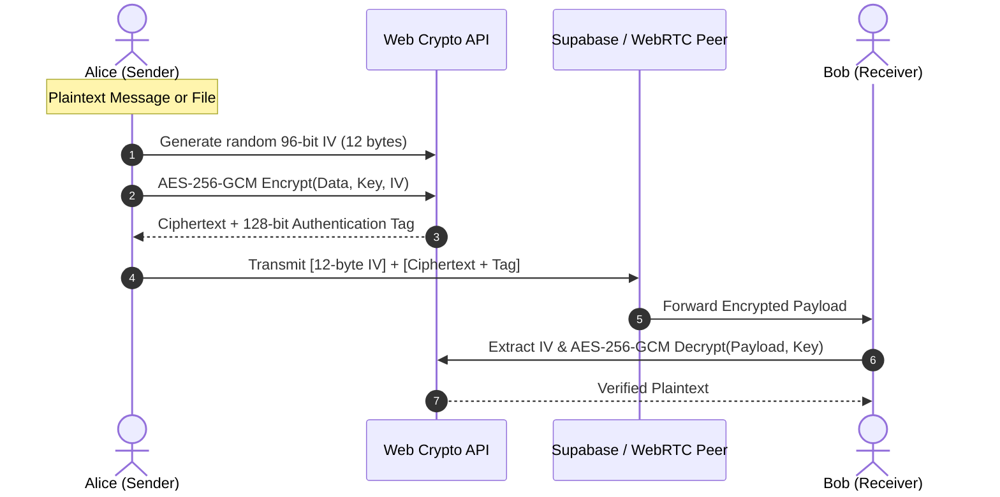

<div align="center">

# SyncPadIO ⚡

**High-Performance, Zero-Knowledge Ephemeral Collaboration & Direct P2P Sharing Platform**

An open-source, developer-first collaboration workspace. Share real-time code snippets, notes, documents, and multi-gigabyte files with **zero accounts, zero server tracking, client-side AES-256-GCM encryption**, and **direct WebRTC peer-to-peer streaming**.

[](https://github.com/simply1git/SyncPadIO/actions/workflows/ci.yml)
[](https://github.com/simply1git/SyncPadIO)
[](https://sync-pad-io.vercel.app)
[](https://www.typescriptlang.org/)
[](https://react.dev/)
[](https://tailwindcss.com/)
[](https://webrtc.org/)
[](LICENSE)

[**Explore Live Application**](https://sync-pad-io.vercel.app) · [**Architecture**](#-system-architecture) · [**Security Model**](#-security--cryptography-model) · [**Quick Start**](#-quick-start)

</div>

---

## 📑 Table of Contents

- [Overview](#-overview)
- [Key Features](#-key-features)
- [System Architecture](#-system-architecture)
- [Security & Cryptography Model](#-security--cryptography-model)
- [Direct P2P Streaming vs Cloud Storage](#-direct-p2p-streaming-vs-cloud-storage)
- [Tech Stack](#-tech-stack)
- [Quick Start](#-quick-start)
- [Database Schema (Supabase)](#-database-schema-supabase)
- [Production Deployment](#-production-deployment)
- [Quality Assurance & Testing](#-quality-assurance--testing)
- [License](#-license)

---

## 💡 Overview

SyncPadIO was engineered to eliminate the friction and surveillance of traditional sharing tools. In seconds, developers can spawn an encrypted session, share syntax-highlighted code or multi-gigabyte media, lock sessions with device biometrics, and disconnect—leaving zero footprint behind.

- **No Sign-ups or Tracking:** Instant disposable rooms via 6-character mnemonic codes or custom vanity names.
- **True Zero-Knowledge Privacy:** Cryptographic keys reside exclusively in the client URL hash (`#k=...`) and are never dispatched over HTTP.
- **Infinite Scalability with P2P:** Send files of any size directly between browser endpoints using WebRTC DataChannels with zero cloud storage costs.
- **Local-First Reliability:** Offline drafting via IndexedDB ensures zero data loss during network dropouts, auto-syncing upon reconnect.

---

## ✨ Key Features

| Capability | Description |
| :--- | :--- |
| 🔐 **Zero-Knowledge E2EE** | Client-side AES-256-GCM encryption via native Web Crypto API. Servers only handle ciphertext; decryption occurs exclusively in memory. |
| ⚡ **Direct P2P WebRTC Streaming** | Stream files of **unlimited size** directly between peer browsers in 64 KiB chunks with automated backpressure flow control (256 KiB threshold). |
| ☁️ **Encrypted Cloud Uploads** | Fast chunked XHR uploads up to 50MB per file with per-transfer progress metrics, pause/cancel controls, and client-side ciphertext verification. |
| 👆 **Biometric Passkey Lock** | Lock active browser sessions with hardware biometrics (Touch ID, Face ID, Windows Hello) via W3C WebAuthn standards. |
| 📱 **Offline-First IndexedDB Engine** | Full offline support. Compose snippets and queue actions without internet; drafts auto-flush in order when connectivity resumes. |
| 🎨 **Smart Syntax Highlighting** | Heuristic language auto-detection across 50+ languages with dark/light themes, inline line numbers, and live Markdown rendering. |
| 📦 **One-Click Batch Downloads** | Download all files shared in a session packaged as a clean `.zip` archive (via JSZip) or sequentially to your local filesystem. |
| ⏱️ **Flexible Lifecycle Policies** | Default **Ephemeral** (purged 5 min after users leave or after 1h idle) or **Creator 24h Safe Room** (preserved across reboots/desertion). |
| 🛡️ **Hardened Production CSP** | Strict Level 3 Content Security Policy, `nosniff`, `DENY` framing, zero tracking cookies, and full origin isolation. |

---

## 🏗️ System Architecture

SyncPadIO employs a modern hybrid architecture combining Edge CDN delivery, Supabase Realtime signaling, and direct WebRTC browser-to-browser pipes.

```mermaid
graph TD
    subgraph Clients["Browser Client Layer"]
        A["Sender Browser<br/>(React 18 + Web Crypto)"]
        B["Receiver Browser<br/>(React 18 + Web Crypto)"]
    end

    subgraph Edge["Vercel Edge Network"]
        V["Production PWA Shell<br/>(HTTP/2 + Clean CSP + Workbox)"]
    end

    subgraph Cloud["Supabase Cloud Infrastructure"]
        RT["Realtime Engine (WebSockets)<br/>• Presence Tracking<br/>• WebRTC Signaling Handshake"]
        DB[("PostgreSQL 15<br/>• Row-Level Security<br/>• Auto-Purge Cascades")]
        ST["Encrypted Storage Bucket<br/>(AES-256-GCM Blobs)"]
    end

    subgraph P2P["Direct Browser Tunnel"]
        DC["WebRTC DataChannel (SCTP/DTLS)<br/>• 64 KiB Binary Chunks<br/>• Zero Cloud Storage"]
    end

    A <-->|Realtime Presence & WebRTC Signaling| RT
    B <-->|Realtime Presence & WebRTC Signaling| RT
    A -->|Encrypted Cloud Upload| ST
    B -->|Download & Decrypt| ST
    A <-->|Direct P2P Stream (Unlimited Size)| DC
    DC <--> B
    V -.->|Serves Static Bundle| A
    V -.->|Serves Static Bundle| B
    RT --- DB
```

---

## 🔐 Security & Cryptography Model

### 1. URL Hash-Based Zero-Knowledge Encryption
According to **RFC 3986 §3.5**, the URL fragment identifier (`#k=...`) is strictly evaluated on the client agent and is **never transmitted in HTTP request headers**.
- Keys are generated locally via `window.crypto.getRandomValues(new Uint8Array(32))`.
- The key is appended to the room URL hash (`https://sync-pad-io.vercel.app/?room=CODE#k=ENCRYPTION_KEY`).
- Hosting providers (Vercel), DNS resolvers, and database backends (Supabase) observe only the room identifier, never the encryption secret.

### 2. Cryptographic Implementation (AES-256-GCM)


- **Algorithm**: `AES-GCM` with a 256-bit key and 96-bit unique Initialization Vector (IV) generated per message/file.
- **Integrity**: Authenticated encryption ensures any tampering with ciphertext causes immediate decryption failure.
- **Hardware Acceleration**: Powered by native browser Web Crypto (`SubtleCrypto`), ensuring near line-speed encryption (~400MB/s).

---

## ⚡ Direct P2P Streaming vs Cloud Storage

SyncPadIO supports two independent file transmission pipelines depending on your workflow:

```mermaid
flowchart LR
    subgraph Mode1["Direct P2P Stream (WebRTC)"]
        S1["Sender"] -->|Direct 64 KiB Chunks| R1["Receiver"]
        style Mode1 fill:#0f172a,stroke:#38bdf8,stroke-width:2px
    end

    subgraph Mode2["Encrypted Cloud Upload (Supabase)"]
        S2["Sender"] -->|Encrypted Upload| CL[("Cloud Storage")] -->|Encrypted Download| R2["Receiver"]
        style Mode2 fill:#0f172a,stroke:#f59e0b,stroke-width:2px
    end
```



| Dimension | Direct P2P Stream (WebRTC) | Cloud Storage Upload |
| :--- | :--- | :--- |
| **Max File Size** | **Unlimited** (Gigabytes / Terabytes) | Up to 50 MB per file |
| **Server Storage** | **Zero bytes** stored anywhere | Encrypted file stored in Supabase |
| **Persistence** | Ephemeral (real-time stream) | Persists for room lifetime |
| **Online Requirement** | Both sender & receiver online simultaneously | Asynchronous (peers download anytime) |
| **Network Protocol** | WebRTC DataChannel (SCTP over DTLS) | HTTPS multipart streaming (XHR) |
| **Ideal For** | Large video raw files, ISOs, private archives | Documents, configuration files, screenshots |

---

## 🛠️ Tech Stack

- **Frontend Core:** React 18 · TypeScript 5.2 · Vite 5
- **Styling & UI:** Tailwind CSS · Lucide Icons · JetBrains Mono & Inter typography
- **Real-Time Backend:** Supabase (PostgreSQL 15, Row-Level Security, Realtime WebSockets)
- **Data & State:** IndexedDB (Local-First Offline Outbox) · Web Crypto API (`AES-256-GCM`)
- **P2P Streaming:** WebRTC DataChannels (`RTCDataChannel`, Google STUN infrastructure)
- **Security:** WebAuthn (`PublicKeyCredential` Hardware Biometrics) · Level 3 CSP
- **Testing & Quality:** Vitest 2.1 · ESLint 8 · TypeScript Strict Mode

---

## 🚀 Quick Start

### Prerequisites
- Node.js `18.0.0` or higher
- `npm` or `pnpm`

### 1. Clone the Repository
```bash
git clone https://github.com/simply1git/SyncPadIO.git
cd SyncPadIO
```

### 2. Configure Environment Variables
Create a `.env` file inside the `client` directory:
```bash
cp client/.env.example client/.env
```
Populate your credentials from your [Supabase Dashboard](https://supabase.com):
```env
VITE_SUPABASE_URL=https://your-project.supabase.co
VITE_SUPABASE_ANON_KEY=your-anon-public-key
```

### 3. Install & Run Locally
```bash
# Install dependencies with lockfile parity
npm --prefix client install

# Launch Vite dev server
npm --prefix client run dev
```
Open [http://localhost:5173](http://localhost:5173) in your browser.

---

## 🗄️ Database Schema (Supabase)

SyncPadIO runs on Supabase PostgreSQL with strict Row-Level Security (RLS). Execute [`supabase_schema.sql`](supabase_schema.sql) in your Supabase SQL Editor.

The migration sets up:
1. **`rooms` Table:** Tracks room codes, creator ownership, presence metadata, and 24-hour expiration flags (`keep-24h` vs `active`).
2. **`snippets` Table:** Stores encrypted snippet payloads with foreign key cascade to parent room.
3. **`files` Table:** Metadata registry for encrypted file storage objects.
4. **Automated Purge Functions:** `cleanup_expired_24h_rooms()` triggers database cascades to delete expired records and orphaned storage blobs cleanly.

---

## 🚢 Production Deployment

### Deploying on Vercel
SyncPadIO is production-ready for deployment on Vercel:

1. Push your code to GitHub.
2. Import your repository into the [Vercel Dashboard](https://vercel.com).
3. Set the **Root Directory** to `client` (or leave root; [`vercel.json`](vercel.json) handles both configurations automatically).
4. Add `VITE_SUPABASE_URL` and `VITE_SUPABASE_ANON_KEY` to your Vercel Environment Variables.
5. Deploy!

### 24/7 Keep-Alive Automation
To ensure Supabase Free Tier databases do not auto-pause after inactivity periods, SyncPadIO includes a dedicated GitHub Actions workflow ([`.github/workflows/keep-alive.yml`](.github/workflows/keep-alive.yml)) that pings the REST health endpoint every 4 hours.

---

## 🧪 Quality Assurance & Testing

SyncPadIO maintains a comprehensive automated testing suite:

```bash
# Execute Vitest unit test suite (38/38 passing)
npm --prefix client test

# Run ESLint static analysis (0 errors, 0 warnings)
npm --prefix client run lint

# Compile production bundle & typecheck
npm --prefix client run build
```

### Verified Test Suites:
- `crypto.test.ts`: AES-256-GCM encryption, decryption, IV integrity, URL hash serialization, and PBKDF2 derivations.
- `webrtcTransfer.test.ts`: Signaling state transitions, 64 KiB chunking, backpressure limits, and STUN connectivity.
- `offlineStore.test.ts`: IndexedDB transaction durability, pending snippet queues, and deduplication logic.
- `webAuthn.test.ts`: Biometric credential creation, challenge verification, and passkey storage.
- `helpers.test.ts`: Room code sanitization, file size formatting, code syntax heuristics, and executable validation.

---

## 📄 License

This project is licensed under the **MIT License** — see the [LICENSE](LICENSE) file for details.

```
Copyright (c) 2026 simply1git
```

<div align="center">
Built with privacy, performance, and simplicity at heart.
</div>
